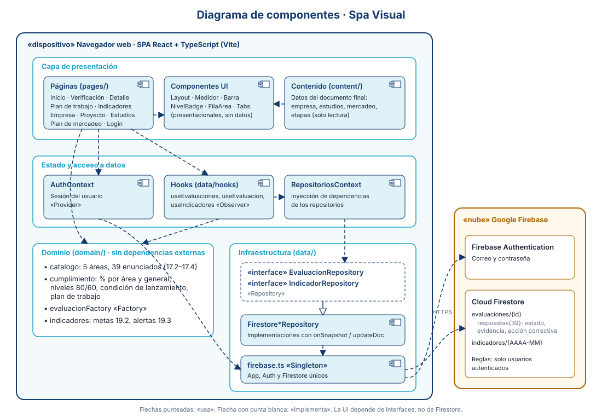

# proyectoAdmin · Herramienta de implementación de Spa Visual

Aplicación web para la **Clínica Preventiva Visual** (Óptica CSG S.A.). Es la versión interactiva de la
**herramienta de apoyo para la implementación** de Spa Visual, descrita en el apartado 17 del trabajo
*Proyecto Final – Gestión – II semestre 2026* (Grupo 01, TEC). Toma como referencia de formato el Excel de ejemplo de Aqua Mascotas.

**En línea:** https://spavisual-cpv.web.app

## Tecnología

- React 19 + TypeScript + Vite
- Firebase Authentication (usuario y contraseña) y Cloud Firestore
- Vitest para las pruebas del dominio

## Diagramas

**Casos de uso**


**Componentes**



## Arquitectura y patrones de diseño

```
src/
├─ domain/      Reglas de negocio puras (sin React ni Firebase) + pruebas
├─ data/        Repositorios, implementación Firestore, hooks en tiempo real
├─ auth/        Contexto de sesión
├─ content/     Contenido del documento final (solo lectura)
├─ components/  Componentes de presentación
└─ pages/       Pantallas
```

| Patrón | Dónde | Por qué |
|---|---|---|
| **Repository** | `data/repositorios.ts`, `data/firestoreRepositorios.ts` | La UI depende de interfaces (`EvaluacionRepository`, `IndicadorRepository`, `UsuarioRepository`), no de Firestore. Se puede cambiar el almacenamiento o probar con datos en memoria. |
| **Singleton** | `data/firebase.ts` | Una sola instancia de App, Auth y Firestore. |
| **Factory** | `domain/evaluacionFactory.ts` | Crea una verificación con los 39 requisitos del catálogo, ya sea vacía o copiando una verificación anterior. |
| **Observer** | `data/hooks.ts` (`onSnapshot`) | Las pantallas se actualizan en tiempo real si otra persona (p. ej., la secretaria) edita la evidencia. |
| **Inyección de dependencias / Provider** | `RepositoriosContext`, `AuthContext` | Los componentes reciben los repositorios y la sesión por contexto en lugar de crearlos. |
| **Tabla de umbrales** | `domain/cumplimiento.ts` (`UMBRALES`) | Los niveles 80/60 se definen en un solo lugar. |

### Modelo de datos (Firestore)

```
evaluaciones/{id}
  nombre, etapa ('preparacion' | 'prelanzamiento' | 'trimestral'), fecha, creadoPor,
  creadoEn, actualizadoEn, actualizadoPor,
  respuestas: { "MV-1": { estado, evidencia, accion?: { descripcion, responsable, recursos,
                                                         fechaCumplimiento, completada } }, … 39 }

indicadores/{AAAA-MM}
  mes, mesOperacion, sesionesRealizadas, sesionesDisponibles, pacientesRecomendados, pacientesAgendaron,
  clientesPrimeraVez, clientesSegundaSesion60d, encuestasRespondidas, encuestasCon4o5, ingresos,
  precioPromedioDefinido, gastoReal, gastoPresupuestado, nuevosConsulta, nuevosRedes,
  nuevosReferidos, nuevosAlianzas, resenasGoogle

usuarios/{uid}
  usuario, nombre, puesto, creadoEn
```

Las 39 respuestas se guardan dentro del documento de la verificación. Así, una sola lectura trae la verificación completa y cada cambio actualiza solo su campo (`respuestas.MV-1`).
Las reglas de seguridad (`firestore.rules`) permiten leer y escribir solo a usuarios autenticados y validan la estructura.
Cada persona solo puede escribir su propio perfil en `usuarios`.

## Ejecutar en local

Requisitos: Node.js 20 o superior.

```bash
npm install
cp .env.example .env.local   # completar con la configuración web de Firebase
npm run dev                  # http://localhost:5180
```

Otros comandos:

```bash
npm test          # pruebas del dominio (Vitest)
npm run build     # compilación de producción en dist/
```

## Acceso

En la pantalla de inicio se usa **usuario y contraseña** (sin correo). El botón **Crear usuario** pide:

- **Nombre** y **puesto** de la persona (texto libre; solo no pueden quedar vacíos).
- **Usuario**: letras, números, punto, guion y guion bajo (3 a 30 caracteres).
- **Contraseña** (mínimo 6 caracteres) y la **contraseña repetida**, que debe ser idéntica.

El nombre y el puesto se guardan en `usuarios/{uid}` y se muestran en el menú lateral. Como Firebase Authentication
requiere un correo, el usuario se convierte internamente en `usuario@usuarios.proyectoadmin-46d4e.firebaseapp.com`.
No se envía ningún correo.
