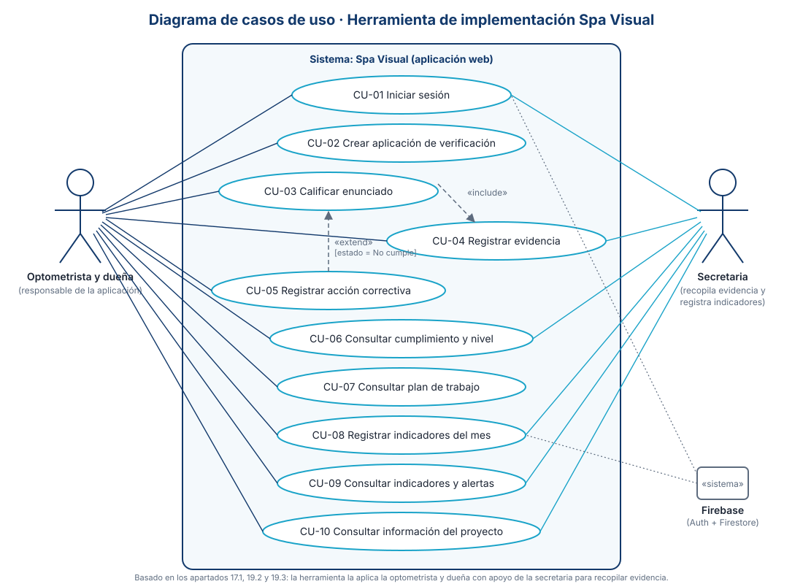

# proyectoAdmin · Herramienta de implementación de Spa Visual

Aplicación web para la **Clínica Preventiva Visual** (Óptica CSG S.A.). Es la versión interactiva de la
**herramienta de apoyo para la implementación** de Spa Visual, descrita en el apartado 17 del trabajo
*Proyecto Final – Gestión – II semestre 2026* (Grupo 01, TEC). Toma como referencia de formato el Excel de ejemplo de Aqua Mascotas.

## Qué hace

| Módulo | Fuente en el documento | Descripción |
|---|---|---|
| **Verificación** | 17.1 – 17.4 | 39 enunciados en 5 áreas (mercado y ventas, marca y gestión digital, técnico, organizacional, legal y ambiental). Cada uno se califica **Cumple / No cumple / Pendiente**, con evidencia. |
| **Cumplimiento** | 17.1 | % por área (cumplen ÷ total del área) y % general. Niveles: **≥ 80 %** lista · **60–79 %** avanzar con ajustes · **< 60 %** no preparada. |
| **Condición de lanzamiento** | 19.1 | 80 % o más en cada área + habilitación sanitaria aprobada. |
| **Plan de trabajo** | 17.1 | Cada «No cumple» registra acción correctiva, responsable, recursos y fecha de cumplimiento. |
| **Aplicaciones** | 17.1, 19.3 | Preparación, antes del lanzamiento y seguimiento trimestral. Una aplicación nueva puede partir de una anterior. |
| **Indicadores de seguimiento** | 19.2, 19.3 | Registro mensual: sesiones, ocupación, conversión, retorno, satisfacción, ingreso promedio, presupuesto, canales y reseñas, con sus metas. Alerta cuando un indicador falla **dos meses consecutivos** y muestra la acción correctiva del área. |
| **Información** | 1–16, 18 | Empresa, proyecto, estudios (mercado, técnico, organizacional, legal, ambiental, financiero) y plan de mercadeo, en modo de solo lectura. |

## Tecnología

- React 19 + TypeScript + Vite
- Firebase Authentication (correo y contraseña) y Cloud Firestore
- Vitest para las pruebas del dominio

## Diagramas

**Casos de uso**



**Componentes**


## Arquitectura y patrones de diseño

```
src/
├─ domain/      Reglas de negocio puras (sin React ni Firebase) + pruebas
├─ data/        Repositorios, implementación Firestore, hooks en tiempo real
├─ auth/        Contexto de sesión
├─ content/     Contenido del documento final (solo lectura)
├─ components/  Componentes de presentación
└─ pages/       Pantallas
```

| Patrón | Dónde | Por qué |
|---|---|---|
| **Repository** | `data/repositorios.ts`, `data/firestoreRepositorios.ts` | La UI depende de interfaces (`EvaluacionRepository`, `IndicadorRepository`), no de Firestore. Se puede cambiar el almacenamiento o probar con datos en memoria. |
| **Singleton** | `data/firebase.ts` | Una sola instancia de App, Auth y Firestore. |
| **Factory** | `domain/evaluacionFactory.ts` | Crea una aplicación con los 39 enunciados del catálogo, ya sea vacía o copiando una aplicación anterior. |
| **Observer** | `data/hooks.ts` (`onSnapshot`) | Las pantallas se actualizan en tiempo real si otra persona (p. ej., la secretaria) edita la evidencia. |
| **Inyección de dependencias / Provider** | `RepositoriosContext`, `AuthContext` | Los componentes reciben los repositorios y la sesión por contexto en lugar de crearlos. |
| **Tabla de umbrales** | `domain/cumplimiento.ts` (`UMBRALES`) | Los niveles 80/60 se definen en un solo lugar. |

### Modelo de datos (Firestore)

```
evaluaciones/{id}
  nombre, etapa ('preparacion' | 'prelanzamiento' | 'trimestral'), fecha, creadoPor,
  creadoEn, actualizadoEn, actualizadoPor,
  respuestas: { "MV-1": { estado, evidencia, accion?: { descripcion, responsable, recursos,
                                                         fechaCumplimiento, completada } }, … 39 }

indicadores/{AAAA-MM}
  mes, mesOperacion, sesionesRealizadas, sesionesDisponibles, pacientesRecomendados, pacientesAgendaron,
  clientesPrimeraVez, clientesSegundaSesion60d, encuestasRespondidas, encuestasCon4o5, ingresos,
  precioPromedioDefinido, gastoReal, gastoPresupuestado, nuevosConsulta, nuevosRedes,
  nuevosReferidos, nuevosAlianzas, resenasGoogle
```

Las 39 respuestas se guardan dentro del documento de la evaluación. Así, una sola lectura trae la evaluación completa y cada cambio actualiza solo su campo (`respuestas.MV-1`).
Las reglas de seguridad (`firestore.rules`) permiten leer y escribir solo a usuarios autenticados y validan la estructura.

## Ejecutar en local

Requisitos: Node.js 20 o superior.

```bash
npm install
cp .env.example .env.local   # completar con la configuración web de Firebase
npm run dev                  # http://localhost:5180
```

Las cuentas de acceso se crean en **Firebase Console → Authentication → Usuarios → Agregar usuario**.

Otros comandos:

```bash
npm test          # pruebas del dominio (Vitest)
npm run build     # compilación de producción en dist/
```

## Publicar en línea (siguiente paso)

El proyecto ya incluye `firebase.json` para Firebase Hosting:

```bash
npm run build
npx firebase-tools deploy --only hosting,firestore:rules
```
